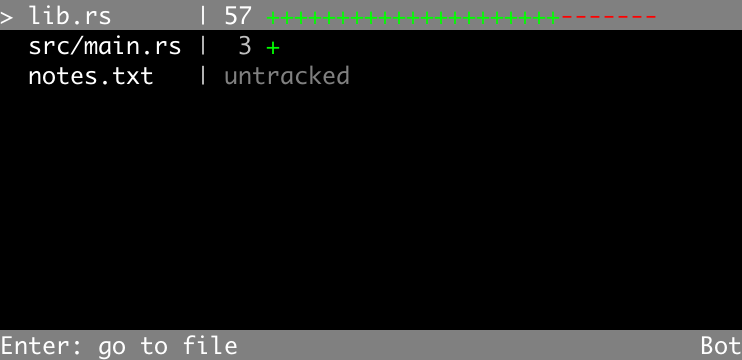

# sl-tui

A terminal UI for [Sapling](https://sapling-scm.com/). It shows the
smartlog, a live working-copy diff, and a single commit or pull
request, in one pager.

While an agent is editing the tree, the diff is re-run on an interval.
When the output changes, the scroll position is kept and the current
file header stays pinned.

Sapling is used when the repository already has sl metadata (`.sl` or
`.git/sl`). Otherwise the repository is treated as git.

## Features

- Smartlog (`t`), drawn from `sl smartlog`, with GitHub or Origin PR links
- Live working-copy diff that keeps the scroll position
- Commit view (`-c`, or Enter in the smartlog) and diff against the previous commit
- Git and Sapling
- Origin and GitHub pull request diffs
- Pinned file header
- Untracked files on the status bar and in the diff stat
- Diff stat (`s`), including the commit message in `-c` mode
- Wrapped lines stay one logical line, so a double-click selects the whole word
- `less`-like navigation, including search and marks

## Screenshots

Diff view, scrolled partway down. The first file's header stays
pinned and the top of its diff is off-screen; the pane shows the tail
of that diff and the start of the next file. `/bar` highlights the
matches. The status bar shows the untracked count and the scroll
position.


Diff stat for the same tree.



## Installation

```
cargo install --git https://github.com/stepancheg/sl-tui
```

or `bin/live-diff`

## Options

| Flag | Meaning |
| --- | --- |
| `-n`, `--interval` | Seconds between runs (default `0.5`, or `LIVE_DIFF_INTERVAL`) |
| `-r`, `--rev` | Revision to compare against. Without this, the tool's default diff |
| `-c`, `--change` | Commit message and diff for one commit. No live refresh |
| `--origin-pr N` | Origin PR diff (`origin pr diff N`). No live refresh |
| `--github-pr N` | GitHub PR diff (`gh pr diff N`). No live refresh |
| `-U`, `--unified` | Initial context lines (default 3). `u` / `U` change it later |
| `--sl` | Force `sl diff` |
| `--git` | Force `git diff` |

## Keys

| Key | Action |
| --- | --- |
| `h` | Help |
| `q` | Quit |
| `r` | Run the diff now |
| `j` / `k`, arrows | Scroll |
| `Space` / `PgDn`, `PgUp` | Page |
| `g` / `G` | Top / bottom |
| `/` `?` `n` `N` | Search |
| `s` | Diff stat (Enter or `s` opens the file, Esc returns) |
| `d` | Diff mode: default, `-c .`, or `-r prev` |
| `t` | Smartlog (Enter opens that commit, or the working-copy diff on `@`; Esc returns) |
| `u` / `U` | Decrease / increase context |
| `mx` / `'x` | Set / go to mark |

Untracked files are counted on the status bar and listed after the stat.
